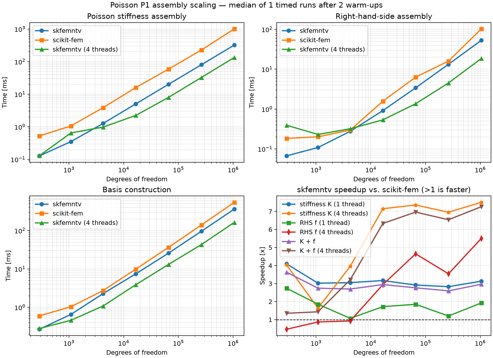

# scikit-fem-native: native assembly for scikit-fem-style Python workflows

[](https://pypi.org/project/scikit-fem-native/)
[](https://pypi.org/project/scikit-fem-native/)
[](https://github.com/kevin-tofu/scikit-fem-native/actions/workflows/ci.yml)
[](https://scikit-fem-native.readthedocs.io/en/latest/)
[](https://github.com/kevin-tofu/scikit-fem-native/blob/main/LICENSE)

**scikit-fem-native** is an independent native finite-element assembly engine for
[scikit-fem](https://github.com/kinnala/scikit-fem)-style Python workflows.  It
accelerates reusable assembly, geometry, quadrature, and sparse-scatter kernels
while preserving readable Python weak forms and, for its supported feature
subset, scikit-fem-compatible DOF ordering and numerical results.

> [!IMPORTANT]
> The distribution is named `scikit-fem-native` and imported as `skfemntv`.  It is
> an independent project, not an official scikit-fem distribution or backend.

## Motivation

The project exists to improve the performance of Python assembly workflows
represented by scikit-fem without replacing their Python programming model.
Weak forms, nonlinear constitutive updates, contact formulations, and solver
policy remain ordinary Python components; stable and reusable numerical kernels
are moved to native code where doing so provides a practical benefit.

This boundary is becoming more important in the era of AI-assisted coding.
Application-specific nonlinear formulations can now be developed, reviewed,
and revised rapidly when they remain small, explicit Python components.
Libraries such as scikit-fem therefore become more valuable, not less: they
provide a transparent mathematical vocabulary while avoiding the cost of
embedding every new formulation in a monolithic compiled solver.

`scikit-fem-native` aims to combine that flexibility with faster assembly.  It is a
selectable backend for Python finite-element applications, not a separate owner
of their material models or physical formulations.

## Built on the work of scikit-fem

This project exists because
[scikit-fem](https://github.com/kinnala/scikit-fem) demonstrated how effective
a finite-element library can be when mathematical forms remain concise,
readable Python.  scikit-fem is implemented in pure Python, which makes its
environment straightforward to install, inspect, and reproduce across
development machines, notebooks, and CI systems.  Its small and composable API
makes the connection between a weak formulation and the assembled system
unusually clear.  That transparency is valuable for teaching and research, but
also for production engineering: new elements, multiphysics terms, nonlinear
material models, and contact formulations can be inspected and changed without
hiding the governing equations behind a large generated or compiled framework.
See the [scikit-fem documentation](https://scikit-fem.readthedocs.io/) for its
installation guide, examples, and API reference.

scikit-fem also provides the practical foundation on which `scikit-fem-native` is
built: its public abstractions, element conventions, DOF ordering, examples,
and extensive body of implementation work define the compatibility target of
this project.  `scikit-fem-native` does not seek to replace that contribution.  It
explores how selected assembly kernels can be accelerated while preserving the
Python-first model that makes scikit-fem useful.

We are grateful to the scikit-fem authors and contributors.  The usefulness of
this backend is a direct consequence of the careful design and sustained work
of that community.

## Installation

```bash
python -m pip install scikit-fem-native
```

The distribution is named `scikit-fem-native`; import it as `skfemntv`.

## Quick start

```python
import skfemntv
from skfemntv.helpers import dot, grad

mesh = skfemntv.MeshTet()
basis = skfemntv.Basis(mesh, skfemntv.ElementTetP1())

@skfemntv.BilinearForm
def diffusion(u, v, w):
    return dot(grad(u), grad(v))

matrix = skfemntv.asm(diffusion, basis)
```

Applications can select `skfem.asm` or `skfemntv.asm` at their backend
boundary while preserving the weak-form call site.  `skfemntv` is not yet a
complete replacement for every scikit-fem feature, so backend selection should
remain explicit.

## Experimental H(div): affine RT0 simplices

Affine triangle and tetrahedron RT0 elements are available through the public
`Basis` / `asm` API. `dot(u, v)`, `div(u) * div(v)`, vector-load forms, and
rectangular `div(q) * p` coupling to DG0 are supported. Cell quadrature is
computed by the C++ backend; sparse facet-DOF accumulation currently uses
Python/SciPy. `FacetBasis` supports normal-trace evaluation, linear loads such
as `dot(q, w.n)`, and weighted normal-trace bilinear forms such as
`dot(u, w.n) * dot(v, w.n)`. Tensor-weighted mass forms such as
`dot(mul(K, u), v)` accept constant tensors and component-first quadrature
tensors. Curved and higher-order H(div) elements are not implemented.

```python
import skfemntv

mesh = skfemntv.MeshTri.init_tensor([0., 0.5, 1.], [0., 0.5, 1.])
basis = skfemntv.Basis(mesh, skfemntv.ElementTriRT0(), intorder=4)

@skfemntv.BilinearForm
def mass(u, v, w):
    return skfemntv.helpers.dot(u, v)

matrix = skfemntv.asm(mass, basis)

pressure = skfemntv.Basis(
    mesh, skfemntv.ElementDG(skfemntv.ElementTriP0()), intorder=4
)

@skfemntv.BilinearForm
def mixed_divergence(q, p, w):
    return skfemntv.helpers.div(q) * p

mixed_block = skfemntv.asm(mixed_divergence, basis, pressure)
```

## Example analysis: tension of a plate with a hole

This linear plane-stress example fixes horizontal motion at the left edge,
prescribes a small horizontal displacement at the right edge, and leaves
transverse motion free apart from one pinned DOF.  The image shows von Mises
stress normalized by the nominal stress.  With this mesh, the largest
cell-averaged stress is about 3.26 times nominal stress; the plotted value is
an element average, not a pointwise peak.  Refining the angular/radial mesh
from `180×20` to `360×40`, `720×80`, and `1080×120` gave peak ratios of
`3.231`, `3.263`, `3.275`, and `3.278`, respectively.  The reference value
`3` is for an infinite plate with a circular hole; this finite plate has a
hole diameter equal to 36% of its height, so its boundaries affect the peak.


The complete script is [`examples/plate_with_hole_tension.py`](examples/plate_with_hole_tension.py).
It uses PyVista for rendering.  Install the optional visualization packages
with `python -m pip install pyvista vtk`, then run
`python examples/plate_with_hole_tension.py` to regenerate the image.  The
mesh uses a polygonal approximation of the circular hole to keep mesh
generation dependency-free.  The script also reports the free-DOF residual
normalized by the applied boundary contribution, which is about `3e-14` for
this run.

For the supported mesh, element, basis, and assembly subset, the compatibility
target is stronger: changing

```python
import skfem
```

to

```python
import skfemntv as skfem
```

should preserve public DOF ordering and numerical results.  Higher-order DOFs
are numbered by topological entity, following scikit-fem: vertices first,
shared edges or facets next, and element interiors last.  This makes assembled
vectors and matrices directly interchangeable without a coordinate
permutation.

`MeshLine` supports topology queries, named boundary and subdomain tags,
uniform and element-marked refinement, restriction, and element removal.
One-dimensional `Basis` and assembly parity remains incomplete, so this mesh
slice is experimental.

Solver conveniences such as `solve`, `enforce`, and `penalize` are outside the
native assembly backend.  Applications may continue to use scikit-fem or SciPy
for these operations.

## Capabilities

- functional, linear, bilinear, and cross-bilinear assembly
- meshes, elements, bases, tabulation, and quadrature
- caller-supplied tensor coefficient assembly
- threaded native kernels and sparse scatter
- cut-cell and implicit-interface quadrature
- interface supermeshes and contact-facet search
- small-strain J2 plasticity and finite-strain Neo-Hookean material kernels
- experimental multiplicative finite-strain J2 material-point update

`PlaneStrainJ2Assembler` provides small-strain isotropic J2 plasticity on 2D
vector TriP1/TriP2 and Quad4/Quad8/Quad9 fields. It imposes
`epsilon_zz = epsilon_xz = epsilon_yz = 0`, while retaining the out-of-plane
stress and plastic history. Trial evaluation does not mutate committed
history; callers advance it with `commit(evaluation)` only after accepting an
equilibrium step. `examples/plane_strain_j2_patch.py` checks a plastified
affine patch and the assembled consistent tangent against a residual
directional finite difference. This is a material and assembly capability,
not yet a large-rotation forming or tool-contact solver. The app-level example
`examples/plane_strain_j2_load_path.py` connects the assembler to displacement-
controlled incremental Newton solves; each trial uses the previous committed
history, and history is advanced only after equilibrium convergence. Its five
increments converge in 5–6 Newton iterations and reach a maximum equivalent
plastic strain of `8.82e-3`.

`FiniteStrainJ2Material` is an experimental material-point law for the
large-rotation forming path. It uses a multiplicative plastic-gradient history,
Hencky elasticity, isotropic linear or tabulated hardening, and an objective
stress rotation. A 2D plane-strain deformation gradient is embedded in 3D with
`F[2, 2] = 1`. Trial history remains transactional. Its current `dP/dF`
algorithmic tangent is centered finite difference. The law is connected to the
Python-side `PlaneStrainFiniteStrainJ2Assembler` for TriP1/TriP2 total-Lagrangian
elements; this assembler is not yet connected to the rigid-tool forming path.
Material-point checks give zero stress under rigid rotation, preserve
`det(Fp) = 1` to roundoff, match the small-strain J2 response within `0.30%`
at 0.2% axial strain, and have a directional tangent relative error of
`1.6e-9` against an independent stress difference. The assembled tangent has a
directional residual error of `1.7e-10` on a small plastified mesh.

`examples/plane_strain_finite_strain_j2_load_path.py` connects this assembler
to incremental Newton and commits history only after each converged increment.
Using the NUMISHEET tabular hardening curve, a five-step 5% extension path
completed in `28.8 s`, with maximum equilibrium residual `1.9e-7` and final
equivalent plastic strain `5.47e-2`. Residual-only line-search evaluations
skip tangent construction, and plane-strain assembly computes only the in-plane
`dP/dF` block; this reduced the same run from `141.7 s` to `28.8 s`. The run is
a material/assembler Newton-path check, not a forming or contact validation.
Its output is saved in `examples/plane_strain_finite_strain_j2_load_path.json`.

The 3D `J2PlasticityAssembler` covers Tet4/Tet10 and Hex8/Hex20/Hex27
displacement fields. `examples/three_dimensional_j2_punch_contact.py` now
connects it to incremental Newton equilibrium and KKTKit's unilateral contact
solver for a Tet4 sheet between two support lines and a rigid flat punch. The
default 90-node loading/unloading example converges, commits history only at
accepted increments, and reports punch force, center thickness change, and
springback. The default contact mode is node-to-plane. Passing `--facet-contact`
instead collocates the gaps at boundary-triangle centroids and interpolates
the Tet4 face displacement there. On the default `8x4x1` mesh at stroke
`0.001`, this mode completed the four-step loading/unloading path with minimum
gap `-1.4e-17`, maximum equilibrium residual `7.8e-9`, and maximum equivalent
plastic strain `4.74e-3`. This is facet-sampled contact, not mortar surface
integration; both modes remain 3D kernel proofs rather than mesh-converged or
calibrated forming benchmarks. The facet-sampled output is saved in
`examples/three_dimensional_j2_facet_contact.json`.
The same contact/Newton path also accepts the Python `Hill48PlasticityAssembler`
with `--hill48`; at `--maximum-stroke 0.005` the coarse demo develops plastic
strain and unloads with a nonzero residual displacement. This verifies the 3D
anisotropic constitutive path through contact. Combining `--hill48` with
`--facet-contact` also converges the `0.005` loading/unloading path on the
coarse mesh (20 accepted steps, minimum gap `-2.8e-17`, maximum equilibrium
residual `1.0e-7`, maximum equivalent plastic strain `3.70e-2`). Its saved
output is `examples/three_dimensional_hill48_facet_contact.json`. These remain
kernel proofs on a coarse mesh. `examples/hill48_3d_patch.py`
checks the assembled Tet4 tangent directionally (relative error `3.1e-10`).
Adding `--numisheet-material` loads the reference anisotropy and all 51 points
of the tabular hardening curve into the same contact/Newton path. On the
`4x2x1` Tet4 kernel case at stroke `0.005`, the loading/unloading path converges,
reaches equivalent plastic strain `1.21e-2`, and returns a maximum punch force
of `4.00` in the example's consistent force units. The local return equations
are differentiated numerically and the tangent is obtained by implicit
linearization; this remains a Python reference implementation, not a native
batched kernel. The run is not the NUMISHEET geometry or a benchmark comparison.

`examples/plane_strain_three_point_bend_contact.py` is the corresponding 2D
plane-strain case. Its automatic stroke subdivision resolves the default
loading and unloading path. Force/stroke, thickness change, and springback
have been checked across meshes, but remain too mesh-sensitive to use as a
forming prediction without an independent reference and further refinement.
If a requested increment fails, the example retries it as two smaller
increments and only commits history at accepted equilibria. Setting
`--maximum-increment 0.02` for a `0.02` maximum stroke exercises this retry
path; it converges with a maximum equilibrium residual below `2e-8` on the
`16x3` mesh.

The same example now accepts `--curved-tools`, which replaces the flat tools
with an analytic circular punch and two cylindrical die rolls. Gaps and normal
directions are refreshed within each Newton iteration, so the KKT contact step
tracks curved geometry; all top and bottom boundary nodes are candidates, so
the contact set can move as the sheet bends. On the exploratory `16x2` mesh with stroke `0.005`,
the circular-tool load/unload path converges and reaches equivalent plastic
strain `7.24e-3`; the matching flat-tool run also converges. Their peak loads
(`0.0969` curved, `0.242` flat) and thickness changes differ substantially,
which demonstrates why tool geometry must be included in any benchmark
comparison. This remains node-sampled contact with small-strain kinematics and
illustrative material units, not the NUMISHEET tool geometry or reference run.
The 2D example can also load the reference Hill48 ratios and tabular hardening
directly with `--numisheet-material`. A small `8x2` TriP2 curved-tool run
converged through loading and unloading with maximum equivalent plastic strain
`5.11e-4`; its geometry is still illustrative, so its force and springback are
not compared to the NUMISHEET values.

Run `examples/plane_strain_three_point_bend_mesh_study.py` to compare the full
load/unload force curve, peak force, center thickness change, and springback
against the finest requested mesh. A default-stroke study gave the following
mesh trend (the `64x12` mesh is only an internal numerical reference):

| TriP1 mesh | Peak punch force | Center thickness change | Springback z | Max. eq. plastic strain |
| --- | ---: | ---: | ---: | ---: |
| `16x3` | 0.33405 | `+1.98e-5` | `-1.812e-2` | 0.07332 |
| `16x6` | 0.28506 | `-1.66e-5` | `-2.113e-2` | 0.05843 |
| `16x12` | 0.26196 | `-1.25e-4` | `-2.199e-2` | 0.05651 |
| `32x12` | 0.22908 | `+2.94e-5` | `-2.255e-2` | 0.05516 |
| `64x12` | 0.20825 | `+7.06e-5` | `-2.203e-2` | 0.09132 |

Peak force and plastic strain remain mesh-sensitive, and the thickness-change
sign is not stable. These results are useful as a regression baseline, not as
validation against experiment or an independent solver. The `64x12` case takes
several minutes on the reference CPU environment.

The existing assembler also supports TriP2. Repeating the full `0.02` load and
unload path with `--orders 2 --meshes 16x3 16x6` gives a much tighter h-refined
comparison: peak force `0.17799` vs `0.17994` (1.08%), force-curve relative L2
error 1.02%, springback `-2.3745e-2` vs `-2.3889e-2` (0.60%), and the center
thickness changes differ by `4.99e-5`, or 0.050% of the initial thickness.
Maximum equivalent plastic strain differs by 6.9%, so localization still needs
finer resolution. These are internally consistent checks for the illustrative
material and geometry, not values from an experimental reference.
The exact comparison output is stored in
`examples/plane_strain_three_point_bend_p2_mesh_study.json`.

The external validation target is recorded in
`examples/numisheet93_draw_bending_reference.json`. The NUMISHEET '93 case
uses a curved punch/die/holder, a 70 mm stroke, friction, and Hill anisotropy;
the experimental mean flange angle after springback is 17.1 degrees. An
independent LLNL report gives 17.20 degrees for its isotropic-hardening run
and 17.57 degrees for its kinematic-hardening run at the same `2.45 kN`
holder force. That numerical comparison uses a fitted power-law hardening
curve, not the tabular curve in the official Abaqus deck, so it is a useful
method-level reference rather than an exact same-material target. The current
partial-stroke solver does not yet represent the full benchmark conditions;
it is not reported as a direct springback comparison. The profile-contact
output now reports both the signed flange angle and its magnitude, plus the
numerical difference from the experimental mean; the comparison-valid flag
remains false until the benchmark stroke, constitutive model, friction, and
kinematics are represented. See the
[benchmark description](https://docs.software.vt.edu/abaqusv2025/English/SIMACAEEXARefMap/simaexa-c-springback.htm),
its [reference input deck](https://docs.software.vt.edu/abaqusv2025/English/SIMAINPRefResources/springback_std_both_surf.inp),
and Puso's [LLNL report](https://digital.library.unt.edu/ark:/67531/metadc1413779/m2/1/high_res_d/15007612.pdf).
The deck identifies the low-holder-force case (`2.45 kN`) and requests punch
reference-node reaction force and displacement history (`RF`, `U`), which can
provide an independent numerical load-stroke curve. No solver output database
is checked in, and Abaqus is not installed in the current environment, so the
force curve is still unavailable for a direct comparison. This information is
also recorded in the benchmark JSON.

As the first material extension toward that case,
`Hill48PlasticityMaterial` and the experimental
`PlaneStrainHill48Assembler` and `Hill48PlasticityAssembler` accept the six Abaqus stress ratios
`(R11,R22,R33,R12,R13,R23)` and associated flow with either linear or
piecewise-linear tabular isotropic hardening. The material point uses a local nonlinear return map; its
algorithmic tangent comes from implicit differentiation using an analytic local
7x7 Jacobian. This removes the local finite-difference Jacobian from both the
Newton return solve and tangent construction, while the batched material-point
loop remains a Python reference implementation rather than a native kernel.
`examples/hill48_plane_strain_patch.py` checks all six directional yield
normalizations, reduction to the J2 update when all ratios are one, and the
assembled tangent against a residual directional difference. The checked
relative errors are `6.3e-11` for TriP1 and `3.1e-10` for Tet4. The tabular
hardening contact example also converges for TriP2 after the tangent update.
Large deformation, friction, and NUMISHEET-specific tool contact remain
necessary before running the NUMISHEET case. The
official 51-point hardening table is stored in the benchmark JSON and checked
by `examples/numisheet93_material_point.py`; its return consistency error is
below `2e-11` MPa and the assembled tabular-hardening tangent difference is
below `5e-10` on the checked TriP1 patch.
For full-order forming meshes, the example uses the sparse active-set KKT
solver `solve_sparse_contact_step` in `scikit_fvm_native.kktkit_bridge`.
KKTKit's current unilateral solver densifies its reduced system, which suits
small ROM coordinates but scales poorly for hundreds of FE displacement
unknowns. This keeps a direct path open: use sparse KKT for full-order solves,
then project/hyper-reduce the operators and use KKTKit when the primal system is
genuinely small.

The reference JSON now also preserves the die, punch, and holder `START`,
`LINE`, and `CIRCL` profiles plus their cylindrical-surface frame and rigid
reference nodes. `AnalyticalRigidProfile2D` parses those directed line/arc
pieces and computes signed projections. The geometry check example maps the
deck's local profile plane to global X-Z and recovers the expected initial
clearances (`0.61 mm` punch, zero at die and holder). This validates source
geometry ingestion. The generic circular-tool contact example uses the same
line/arc projection API inside its Newton/KKT loop. The following specialized
example connects the source profiles to a half-blank contact path.

`examples/numisheet93_profile_contact.py` is now that profile-coupled partial
forming path. It builds the half blank (`175 x 0.78 mm`), uses all three source
tool profiles and the reference Hill48/hardening data, scales the holder load
to `175 N` for the 5 mm half-model width, and removes tool contact for a static
springback step. A coarse `35x2` continuum mesh converges to `2 mm` stroke,
forms punch contact after the initial `0.61 mm` clearance, develops plastic
strain, and equilibrates after tool removal. Automatic bisection accepted 36
states along the requested 0–2 mm path. The maximum half-model punch force is
`216.86 N`, maximum equivalent plastic strain is `2.81e-2`, and the predicted
springback flange angle is `-0.745°`. The recorded path is
`examples/numisheet93_profile_contact_35x2_2mm.json`. These are partial-stroke
kernel results, not a comparison with the reference `17.1°` springback: the
reference stroke is `70 mm`, this model still uses small-strain kinematics and
a coarse through-thickness mesh. Only one punch sample is within `1e-6 mm` of
contact at 2 mm (near `x=21.31 mm`, on the curved profile), and it remains the
only near-contact sample as it moves from the flat portion to the arc. This
may reflect under-resolution or the partial-stroke deformation path; it is not
evidence of a distributed punch-contact solution. At first contact (`0.7 mm`),
the load is strongly mesh-dependent:

Passing `--finite-strain-j2` now routes the same rigid-profile contact and
springback path through the multiplicative finite-strain J2 assembler with the
reference tabular hardening curve. The very coarse `8x2` run to `0.8 mm`
completed 44 accepted states in `70.3 s`; minimum punch gap was `-6.1e-16 mm`,
maximum equilibrium residual was `1.8e-5 N/mm`, and it produced a half-model
punch force of `393.26 N`, maximum equivalent plastic strain `1.16e-2`,
springback angle magnitude `0.0078°`, and minimum thickness `0.77927 mm`.
The result is saved in
`examples/numisheet93_profile_contact_finite_strain_j2_8x2_0p8mm.json`.
This run verifies that finite-strain J2, the nonlinear contact loop, tool
release, and thickness/angle reporting are connected. It is far too coarse and
stops at `0.8/70 mm`; the angle error is therefore marked invalid. The
`15x2` refinement completes in `37.9 s` and 11 accepted states, with minimum
gap `-5.6e-17 mm`, maximum equilibrium residual `8.4e-6 N/mm`, peak half-model
punch force `160.15 N`, maximum equivalent plastic strain `4.36e-3`, springback
angle magnitude `0.2164°`, and minimum thickness `0.77984 mm` at `x=20.33 mm`.
The result is saved in
`examples/numisheet93_profile_contact_finite_strain_j2_15x2_0p8mm.json`.
The `35x2` run completes in `81.6 s` and 10 accepted states, with minimum gap
`-2.2e-16 mm`, maximum equilibrium residual `3.8e-7 N/mm`, peak half-model
force `74.28 N`, maximum equivalent plastic strain `4.28e-3`, springback angle
magnitude `0.3855°`, and minimum thickness `0.77995 mm` at `x=29.40 mm`. Its
output is `examples/numisheet93_profile_contact_finite_strain_j2_35x2_0p8mm.json`.

For runs that reach the target stroke, `--withdraw-punch-after-forming`
continues the frictionless contact equilibrium path while retracting the punch
back to zero stroke. The accepted plastic history is committed incrementally
along this descending path, and checkpoints record whether punch withdrawal
is in progress so it can resume after interruption. The die and blank holder
remain at their forming positions during punch retraction; their subsequent
release still uses the staged equivalent-reaction springback procedure.
This option is an experimental tool-withdrawal path and should be checked
against finer stroke increments before using its force curve as a benchmark.
The `70x4` case completes in `359.3 s` and 18 accepted states, with minimum
gap `-1.1e-16 mm`, maximum equilibrium residual `1.4e-5 N/mm`, peak half-model
force `44.44 N`, maximum equivalent plastic strain `2.91e-3`, springback angle
magnitude `0.3890°`, and minimum thickness `0.77995 mm` at `x=29.89 mm`. Its
output is `examples/numisheet93_profile_contact_finite_strain_j2_70x4_0p8mm.json`.
Springback uses an L2 residual merit in its backtracking line search; the
infinity norm remains the equilibrium stopping criterion. The force changes
from `74.28 N` on `35x2` to `44.44 N` on `70x4` (40%). The springback angle
changes by only `0.0036°` between those meshes, and the minimum thickness by
`0.0000005 mm`; however, its location shifts from `29.40` to `29.89 mm`, while
equivalent plastic strain also continues to vary. The force and field outputs
are not mesh-converged, and these partial-stroke runs are not benchmark
predictions. The full `70 mm` path remains open work.
The direct formed-state to zero-load springback solve did not converge within
30 Newton iterations (`10.09 N/mm` free residual). Replacing that jump with a
10-stage linear ramp of the formed-state equivalent free-DOF reaction load
reaches the zero-load equilibrium on the same `35x2`, `2 mm` finite-strain
case in `570.8 s`; the final infinity-norm residual meets the `2e-5 N/mm`
tolerance. The final half-model punch force is `194.67 N`, maximum equivalent
plastic strain is `3.137e-2`, springback angle magnitude is `1.7351°`, and
minimum column thickness is `0.778603 mm` at `x=27.20 mm`. The result is saved
in `examples/numisheet93_profile_contact_finite_strain_j2_35x2_2mm.json`.
This ramp is a numerical load-continuation path derived from the forming
reaction; rigid-tool contact is inactive during the ramp, so it is not a
physical tool-withdrawal simulation. The comparison to the 17.1° reference
remains invalid because this is a 2 mm partial-stroke, coarse plane-strain
model with isotropic hardening and no friction.

The same forming driver has an experimental frictionless P0 mortar contact
path. Set `SCIKIT_FVM_FORMING_CONTACT_METHOD=mortar-p0` to use one multiplier
per boundary facet and integrate the signed gap and its consistent Jacobian
with Gauss points. The line search also checks the minimum quadrature-point
gap, so a positive facet-average gap cannot hide local penetration. This path
does not support friction yet and has only been exercised through initial
punch engagement on a coarse finite-strain J2 mesh; it is not validated for a
full forming stroke or benchmark comparison. Point collocation remains the
default. A short invocation is:

```bash
SCIKIT_FVM_FORMING_CONTACT_METHOD=mortar-p0 \
PYTHONPATH=python:../scikit-fvm-mative/python \
python examples/numisheet93_profile_contact.py \
  --nx 24 --nz 2 --maximum-stroke-mm 0.8 --maximum-increment-mm 0.1 \
  --finite-strain-j2 --forming-only
```

Longer forming paths can be checkpointed after every accepted increment and
resumed without losing the committed displacement or plastic history. For
example, run a finite-strain `35x2` path to an initial target with
`--checkpoint /tmp/numisheet93_35x2.npz`, then pass the same checkpoint and
mesh/increment settings with `--resume --maximum-stroke-mm 70` to extend the
path. The requested final stroke may increase on resume; the model, mesh, and
maximum increment must match the checkpoint.
The `TriP1` forming path uses one centroid integration point per affine
triangle; its deformation gradient and stress are elementwise constant, so
this rule exactly integrates the internal residual and tangent. A restart can
losslessly collapse an older checkpoint's identical three-point histories.
For at most 800 contact variables, the nonlinear contact loop retries a failed
sparse unilateral solve through KKTKit's dense active-set implementation.

| Plane-strain mesh | Peak punch force (half model) | Max. eq. plastic strain | Springback flange angle |
| --- | ---: | ---: | ---: |
| `35x2` | 55.02 N | `1.27e-4` | `-0.0100°` |
| `70x4` | 32.04 N | `1.42e-4` | `-0.00574°` |
| `140x6` | 16.34 N | `0` | `-0.00000215°` |

Only one punch facet point is active at `0.7 mm` on all three meshes, so these
results expose the mesh sensitivity of first engagement and the coarse
material integration. They are an integration check, not a load/stroke or
springback benchmark result.

The `--refine-punch-arc` option redistributes the same x-cell count toward the
5 mm punch corner radius. On the `35x2` mesh and 2 mm stroke, it reaches a
maximum half-model force of `213.71 N` and maximum equivalent plastic strain
`2.85e-2`, close to the default distribution (`216.86 N`, `2.81e-2`). However,
the springback angle changes from `-0.745°` to `-1.853°`, and center thickness
changes from `0.7845` to `0.7818 mm`. The refined run has at most two active
punch samples during loading and one near-contact sample at the final stroke.
This same-size redistribution study exposes sensitivity in springback; it is
not an h-convergence result. Its full path is recorded in
`examples/numisheet93_profile_contact_35x2_arc_refined_2mm.json` and can be
reproduced with `--nx 35 --nz 2 --maximum-stroke-mm 2 --maximum-increment-mm
0.2 --refine-punch-arc`.

For thickness reporting, the example also records the distance between the
deformed top and bottom surface nodes in every x column after springback. At
`0.8 mm` stroke, the contact-focused mesh study gives:

| Mesh | Punch force | Max. eq. plastic strain | Springback angle | Minimum column thickness (x) |
| --- | ---: | ---: | ---: | ---: |
| `35x2` | 77.41 N | `4.15e-3` | `-0.3621°` | `0.779946 mm` (`29.40 mm`) |
| `70x4` | 45.82 N | `2.83e-3` | `-0.3547°` | `0.779944 mm` (`29.89 mm`) |
| `140x6` | 31.26 N | `1.78e-3` | `-0.2993°` | `0.779965 mm` (`30.18 mm`) |

The refined `140x6` run completes in `103 s` after separating the sparse
contact solver's gap and force-multiplier tolerances. The force drops by a
further 32% from `70x4` to `140x6`, so force and plastic strain are still far
from mesh convergence even though minimum thickness remains close. Springback
also shifts with refinement. These are partial-stroke numerical checks, not a
validated forming prediction. The saved runs are
`examples/numisheet93_profile_contact_35x2_arc_refined_0p8mm.json`,
`examples/numisheet93_profile_contact_70x4_arc_refined_0p8mm.json`, and
`examples/numisheet93_profile_contact_140x6_arc_refined_0p8mm.json`.
For the rerun `35x2` state, the signed springback angle is `-0.3621°` and its
magnitude differs from the `17.1°` experimental mean by `-16.7379°`. The
output marks this comparison invalid: the run reaches only `0.8 mm` of the
benchmark's `70 mm` stroke and still omits friction and large-deformation
kinematics. The value is a diagnostic of the gap to the target, not a
validation error estimate.

The Hill48 return map now uses an analytic local 7x7 Jacobian, and full-order
contact uses sparse KKT systems instead of densifying the FE matrix. With these
changes, the `70x4` mesh completed the 2 mm path in `478 s` (108 accepted
states); the `35x2` path completed in `113 s` (44 states). Their results are:

| Mesh | Max. punch force | Max. eq. plastic strain | Springback angle | Minimum column thickness (x) |
| --- | ---: | ---: | ---: | ---: |
| `35x2` | 213.72 N | `2.855e-2` | `-1.854°` | `0.780171 mm` (`29.40 mm`) |
| `70x4` | 109.76 N | `2.609e-2` | `-1.933°` | `0.780010 mm` (`3.27 mm`) |

The punch force still changes by about 49% between meshes, although the
springback angle and minimum thickness are closer. The minimum-thickness
location also moves substantially, so the small thickness difference does not
establish spatial convergence. Both paths stop at 2 mm and are not benchmark
comparisons. The fine result is stored in
`examples/numisheet93_profile_contact_70x4_arc_refined_2mm.json`.

Scalar anisotropic diffusion uses the same readable helper syntax as
scikit-fem:

```python
from skfemntv.helpers import dot, grad, mul

@skfemntv.BilinearForm
def anisotropic_diffusion(u, v, w):
    return dot(mul(w.diffusion, grad(u)), grad(v))

A = np.array([[2.0, 0.4], [0.1, 0.8]])
matrix = skfemntv.asm(anisotropic_diffusion, basis, diffusion=A)
```

The recommended public layout is the scikit-fem component-first form
`(dim, dim, entities, quadrature)`.  A constant `(dim, dim)` tensor is also
accepted and broadcast over all integration points.  The entity-first native
layout `(entities, quadrature, dim, dim)` remains accepted for low-level
compatibility, but is not the preferred user-facing representation.  The
native kernel uses that internal layout so each quadrature-local tensor is
contiguous in memory.  Nonsymmetric tensors are retained rather than silently
symmetrized.  This first typed operation targets scalar H1 fields;
vector-field fourth-order constitutive tensors remain separate work.

For numeric component-first arrays, `skfemntv.helpers` also provides the
scikit-fem-compatible `det`, `inv`, `eye`, and `cross` operations. They work on
constant tensors and quadrature data. Using these operations on symbolic
nonlinear form expressions is currently rejected by the typed form compiler.

Coefficient components follow scikit-fem's component-first convention as
well: `w.material[0]` selects axis 0.  Multiple named fields can be used in a
single typed form, for example:

```python
@skfemntv.BilinearForm
def material_form(u, v, w):
    return (
        w.material[0] * dot(u, v)
        + w.material[1] * ddot(grad(u), grad(v))
        + dot(mul(w.diffusion, grad(u)), grad(v))
    )
```

Component indices must be integers.  Missing fields and out-of-range
components are reported with the coefficient name before assembly.

The mathematical compatibility boundary is also available at runtime:

```python
skfemntv.supports("space.h1")       # True
skfemntv.supports("space.hcurl")    # False (experimental opt-in required)
skfemntv.require_capability("space.hcurl")  # precise capability error
```

Use `skfemntv.capabilities()` for the complete machine-readable registry.
Experimental capabilities require `include_experimental=True`; solver policy
is explicitly marked external.

`Basis.project` provides experimental L2 projection for scalar and vector
P0/P1/P2 bases on affine triangular and tetrahedral meshes. It currently
projects over the full basis; composite fields and curved meshes are not
supported.

### Experimental H(curl) simplex slices

The lowest-order first-family Nédélec element is available as a deliberately
small experimental API for affine triangular meshes:

```python
import numpy as np
from scipy.sparse.linalg import spsolve
import skfemntv

mesh = skfemntv.MeshTri.init_tensor(
    np.linspace(0.0, 1.0, 9), np.linspace(0.0, 1.0, 7)
)
basis = skfemntv.AffineTriN1Basis(mesh, intorder=3)
assembler = skfemntv.TriN1Assembler(basis)
linear_assembler = skfemntv.TriN1LinearAssembler(basis)
matrix = assembler.assemble_maxwell(
    mass_coefficient=1.0, curl_coefficient=0.05
).copy()

boundary = basis.boundary_dofs()
free = np.setdiff1d(np.arange(basis.N), boundary)
load = linear_assembler.assemble_vector_load(
    lambda x: np.array((0.0 * x[0], np.sin(np.pi * x[0])))
).copy()
solution = np.zeros(basis.N)
solution[free] = spsolve(matrix[free][:, free], load[free])
```

Analytic vector fields can be interpolated by their globally oriented edge
moments and evaluated at basis quadrature points:

```python
def field(x):
    return np.array((0.0 * x[0], x[0] * x[1]))

edge_values = basis.interpolate_edge_moments(field)
values = basis.evaluate(edge_values)       # (component, cell, quadrature)
curls = basis.evaluate_curl(edge_values)   # (cell, quadrature)
points = basis.global_coordinates          # (component, cell, quadrature)
```

The tetrahedral counterpart uses the same explicit workflow:

```python
axis = np.linspace(0.0, 1.0, 5)
mesh = skfemntv.MeshTet.init_tensor(axis, axis, axis)
basis = skfemntv.AffineTetN1Basis(mesh, intorder=3)
assembler = skfemntv.TetN1Assembler(basis)
linear_assembler = skfemntv.TetN1LinearAssembler(basis)

# TetN1 integration is cell-parallel; applications retain thread ownership.
with skfemntv.thread_limit(4):
    matrix = assembler.assemble_maxwell(
        mass_coefficient=1.0, curl_coefficient=0.05
    ).copy()

load = linear_assembler.assemble_vector_load(
    lambda x: np.array((1.0 + 0.0 * x[0], x[0], -x[1]))
).copy()
boundary = basis.boundary_dofs()
```

TetN1 values and vector curls both use
`(basis, component, cell, quadrature)` publicly; evaluated fields and curls
use `(component, cell, quadrature)`.  The complete runnable example is
`examples/hcurl_tet_n1_maxwell.py`.

These slices include oriented global edge numbering, affine covariant Piola
mapping, mass/curl-curl/Maxwell CSR assembly, coefficient fields, memory
preflight, and boundary-edge selection.  N1 supports affine triangles and
tetrahedra with one tangential moment per edge. The triangle path also supports
`ElementTriN2` and `ElementTriN3` through `Basis`/`asm`, interpolation, point
evaluation, projection, and reusable CSR assembly. N2 has two tangential edge
DOFs and two cell DOFs; N3 has three edge DOFs and six cell DOFs, with edge
functions permuted when a shared edge orientation reverses. TetN2 adds two
DOFs per edge and two transformed DOFs per face; `Basis.interpolate_moments(field)`
computes those edge/face functionals, with edge reversal and face
rotation/reflection matrices are applied per cell. Use
`ElementTriN1`, `ElementTriN2`, `ElementTriN3`, `ElementTetN1`,
`ElementTetN2`, or `ElementTetN3` with the
general `Basis` and `asm` APIs for mass, curl-curl, and vector-load forms.
Boundary tangential conditions can be
selected with `basis.get_dofs()`, including named boundary regions.  TetN3
adds three DOFs per edge, six orientation-transformed DOFs per face, and three
cell-interior DOFs. `Basis.interpolate_moments(field)` supports edge/face
moments for TetN2 and edge/face/cell moments for TetN3. Curved maps and
tetrahedral orders above N3 are not provided. All six spaces support point
evaluation and L2 projection; N1 spaces support edge moment interpolation.
The triangle example is
`examples/hcurl_tri_n1_maxwell.py`; the public `Basis`/`asm` N3 solve is shown
in `examples/hcurl_tri_n3_maxwell.py`. The manufactured-solution comparison in
`examples/hcurl_tri_nedelec_convergence.py` prints L2 and curl errors and their
observed rates for N1, N2, and N3. On the included refinements, the rates tend
toward 1, 2, and 3, respectively.
The tetrahedral comparison is in `examples/hcurl_tet_nedelec_convergence.py`;
its manufactured PEC solution compares N1, N2, and N3 convergence for both
L2 and curl errors. On the included refinements, the observed rates approach
1, 2, and 3, respectively.

The public `Basis` convention follows scikit-fem's N1 global signs. The legacy
`AffineTriN1Basis` API retains its ascending-edge moment convention, so its
coefficient vector has the opposite sign when directly compared with a
`Basis`/scikit-fem coefficient vector on triangles.

`TriN1Assembler` uses NumPy/SciPy integration.  `TetN1Assembler` uses a fused
cell-parallel C++ integration kernel and the same fixed-CSR ownership model.
Names describe their mathematical spaces rather than implementation details.
Assembly methods reuse
and overwrite one result object, so call `.copy()` before another assembly when
results must be retained.  Public basis values use component-first shape
`(basis, component, cell, quadrature)` and curls use
`(basis, cell, quadrature)` for triangles and
`(basis, component, cell, quadrature)` for tetrahedra; coefficient fields use
`(cell, quadrature)`.

`basis.geometry_diagnostics` reports minimum signed/absolute Jacobian
determinants, minimum cell area/volume, an edge-based aspect indicator, and the
number of negatively oriented cells.  An optional `max_aspect_ratio` constructor
argument rejects meshes beyond an application-selected quality limit.  Tests
cover distorted meshes and mixed cell orientations, including manufactured
PDE convergence.  `space.hcurl` remains experimental and supports affine linear
simplex meshes, with triangular and tetrahedral elements through third order.

### Assembly memory preflight

Estimate native bilinear-assembler memory before its CSR pattern and scatter
map are allocated:

```python
estimate = skfemntv.estimate_bilinear_memory(basis)

print(skfemntv.format_bytes(
    estimate.construction_peak_total_bytes_upper_bound
))

if not estimate.fits_in(available_bytes, safety_factor=1.25):
    raise MemoryError("assembly does not fit the configured memory budget")
```

The same check can be enforced atomically before native CSR and scatter-map
allocation:

```python
assembler = skfemntv.NativeBilinearForm(
    basis,
    memory_limit_bytes=16 * 1024**3,
    memory_safety_factor=1.25,
)
```

`NativeCrossBilinearForm` accepts the same options.  A failed check raises
`AssemblyMemoryBudgetError` containing the estimate, configured budget,
safety-adjusted requirement, and largest estimated allocation.  The default
safety factor is 1.25.  Supplying no limit preserves existing behavior and does
not impose a process-wide policy.  Segmented `CutCellBasis` bilinear and cross
assemblers use active-cell counts and flattened cut quadrature in the same
preflight and budget API.

The report separates memory already retained by the basis from persistent
native assembler allocations and temporary CSR-pattern construction memory.
H(curl) assemblers also expose order-specific estimators, including
`estimate_tet_n3_assembly_memory`. These account for the tabulation arrays
retained by the supplied basis and modeled CSR/scatter allocations; they do
not include the Python process baseline, allocator fragmentation, or all
library object overhead, so leave room for those when setting a process-wide
memory budget.
Its CSR nonzero count is a conservative, allocation-free upper bound.  Python
object overhead, allocator fragmentation, and coefficient arrays supplied at
assembly time are intentionally excluded and listed in the report assumptions.

Use `estimate_bilinear_memory(test_basis, trial_basis)` for a rectangular
cross-bilinear block.  For mixed spaces,
`estimate_composite_bilinear_memory(basis, field_pairs=...)` estimates the
selected independently cached blocks; omitting `field_pairs` assumes all
ordered field pairs are assembled once.  Repeat a field pair when distinct
value/gradient contraction kinds create multiple cached native blocks.

## Assembly performance

The following reference run compares warm-cache Poisson P1 matrix and
right-hand-side assembly using identical meshes and spaces.  Results depend on
hardware, thread affinity, and package versions; they are an example rather
than a universal performance guarantee.



See the [benchmark methodology](benchmarks/compare-with-skfem/README.md) and
[recorded environment and values](benchmarks/compare-with-skfem/results/poisson-linux-x86_64.md)
for details.

See [DEVELOPMENT.md](DEVELOPMENT.md) for the motivation, architecture boundary,
and development principles.

## Documentation

Read the [scikit-fem-native documentation](https://scikit-fem-native.readthedocs.io/en/latest/),
including the precise
[scikit-fem compatibility boundary](https://scikit-fem-native.readthedocs.io/en/latest/scikit-fem-compatibility.html)
and the
[assembly performance methodology](https://scikit-fem-native.readthedocs.io/en/latest/scikit-fem-performance.html).

Build the Sphinx documentation locally:

```bash
python -m pip install -e '.[docs]'
sphinx-build -M html docs docs/_build
```

Open `docs/_build/html/index.html` after the build completes.

## Development

```bash
python -m pip install -e '.[test]'
pytest -q
```
