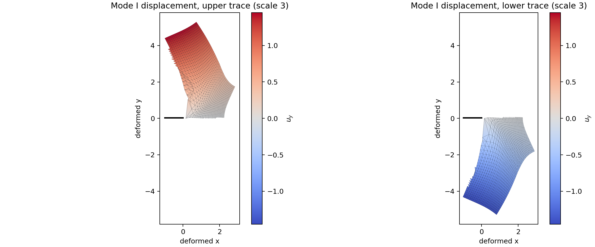
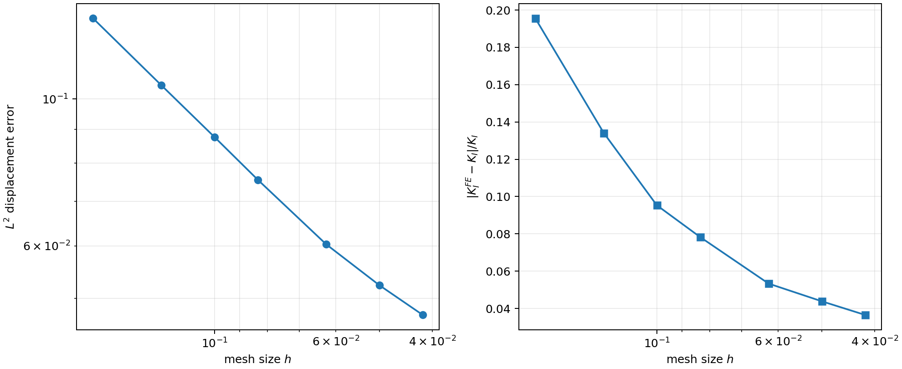

# Mode I edge crack with XFEM

This example solves a fixed, traction-free edge crack in 2D plane strain. The
crack is represented by a level set and crosses background elements; the mesh
is not cut or duplicated along the crack. Shifted-Heaviside enrichment captures
the displacement jump, and four square-root crack-tip functions capture the
leading elastic singular field.

## Reference solution

The imposed displacement is the Mode I Williams field for unit stress intensity
factor $K_I=1$, Young's modulus $E=1$, and Poisson ratio $\nu=0.3$:

$$
u_x=\frac{K_I}{2\mu}\sqrt{\frac{r}{2\pi}}
\cos\frac{\theta}{2}(\kappa-\cos\theta),\qquad
u_y=\frac{K_I}{2\mu}\sqrt{\frac{r}{2\pi}}
\sin\frac{\theta}{2}(\kappa-\cos\theta),
$$

where $\kappa=3-4\nu$ for plane strain. Exact values are imposed on the
outer boundary. The crack faces are traction-free through the natural boundary
condition. We compare the computed displacement with the analytic field and
recover $K_I$ by a weighted least-squares fit of $\sigma_{yy}$ over
$0.20\le r\le0.45$.

The crack tip is a mesh node. A mild vertical warp makes the crack line cross
element interiors behind the tip, so the run exercises cut-cell quadrature as
well as the XFEM enrichment. The domain and mesh are otherwise a square
background grid split into triangles.

## Results

The recorded sequence is in [the convergence CSV](results/mode-i-convergence.csv).
Across resolutions 12 to 32, the relative displacement $L^2$ error falls
from 7.55% to 3.44%; the fitted $K_I$ error falls from 19.6% to 5.33%.
The stress-intensity recovery is more mesh-sensitive than the displacement
norm because it differentiates the finite-element solution and fits stress in
a fixed annulus. Treat the values as a benchmark trend, not a high-accuracy
fracture-integral result.





The final solution and crack metadata are also written to
[the VTU result](results/mode-i-crack.vtu) for inspection in ParaView. It
includes positive and negative crack-face displacement traces, the level set,
and the cut-cell classification.

## Run

From the skfemntv repository root:

```bash
MPLCONFIGDIR=/tmp/matplotlib PYTHONPATH=python \
python examples/xfem_mode_i_crack.py \
  --resolutions 12 16 20 24 32 \
  --output-dir tutorials/mode-i/results
```

The example currently covers small-strain linear elasticity and a stationary
crack. It does not yet implement plasticity, crack propagation, a domain
interaction integral, or contour-independent $J$-integral recovery.
